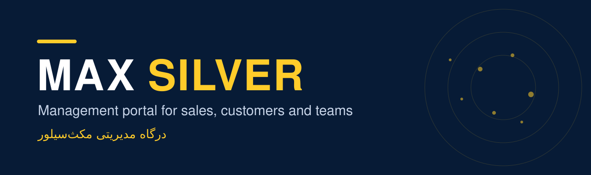

<div align="center">
  
  <h1>MAX SILVER PORTAL</h1>
  <p><strong>One installable workspace for sales, customers, proformas and teams.</strong></p>
  <p>
    <a href="https://soheil-aghayani.github.io/MaxSilver/"><strong>Open the portal →</strong></a>
    ·
    <a href="docs/ADMIN_GUIDE_FA.md"><strong>راهنمای مدیر (فارسی) →</strong></a>
  </p>
  <p>
    
    
    
    
  </p>
</div>

The Max Silver portal is the internal workspace of **Max Silver**, an Iranian manufacturer of commercial kitchen equipment. It brings the CEO dashboard, the customer database, the product catalog with proforma invoices, the sales process, the brand books and the team's conversations into one Persian, right-to-left app that works in a browser and installs on a phone like a native app.

It is a static site: plain HTML, CSS and JavaScript with no build step, hosted on GitHub Pages. Firebase (Authentication and Firestore, Spark plan) adds sign-in, roles, shared data and live notifications. Everything that can work without a connection does.

<details>
<summary><strong>خلاصهٔ فارسی</strong></summary>

درگاه مکث‌سیلور یک برنامهٔ وب نصب‌پذیر (PWA) برای مدیریت فروش است: داشبورد مدیرعامل، پایگاه مشتریان، کاتالوگ و پیش‌فاکتور، نقشهٔ فروش، برندبوک و گفت‌وگوی تیم. هر نقش فقط بخش‌های خودش را می‌بیند و اجرای واقعی دسترسی با قوانین Firestore است. جزئیات تنظیمات در [راهنمای مدیر](docs/ADMIN_GUIDE_FA.md) آمده است.

</details>

## Choose your way in

| Way | Best for | What it needs |
| :--- | :--- | :--- |
| **Web** | A desktop or phone browser | Nothing to install. Open the [live portal](https://soheil-aghayani.github.io/MaxSilver/) and sign in with the account the administrator created. |
| **Installed app (PWA)** | Daily use on a phone or desktop | Use the install prompt or the browser's "Add to home screen". The app opens full screen, with its own icon, and starts offline. |
| **QR code** | Sharing the portal in a meeting | The QR button on any page always encodes the main page, never an inner address. |

Signed-out visitors see only the home page, the sign-in panel and the contact form. Everything else is hidden by role and enforced by the database rules.

## What is inside

| Section | File | What it does |
| :--- | :--- | :--- |
| **Home** | [`index.html`](index.html) | Entry point with a card for every section the role may open. |
| **CEO dashboard** | [`ceo-dashboard.html`](ceo-dashboard.html) | Interactive map of 31 provinces and six sales regions, year comparison, sharing by QR. |
| **Customers** | [`customers.html`](customers.html) | Customer database keyed by accounting code: list, a page per customer, sales per year, group and owner, contact details, import from the accounting reports and branded Excel template. |
| **Sales analysis** | [`sales-analysis.html`](sales-analysis.html) | Filters, charts and tables for customer and product reports, processed only in the browser. |
| **Product catalog** | [`product-catalog.html`](product-catalog.html) | 343 products from three brands with search, filters, comparison and the proforma sheet. |
| **Business planner** | [`planner.html`](planner.html) | A guided first plan for a café, restaurant or fast-food: pick a business, a size and what you serve, get one suggested machine per job, swap or remove each, see the missing supporting items, and send the plan to the proforma. A budget question appears once products carry a level (`assets/product-tiers.json`, filled with `tools/apply_tiers.py`). |
| **Sales process** | [`sales-process.html`](sales-process.html) | The nine-stage sales map with owners, the settlement process, controls, reports and required documents. |
| **Advertising strategy** | [`advertising.html`](advertising.html) | The advertising tree (print, promotional gifts, online) with search and the reference map. |
| **Brand books** | [`brand-books.html`](brand-books.html) | Logo, colours, fonts and voice of the four group brands, with PDF export. |
| **Panel** | [`panel.html`](panel.html) | Personal profile and look, proformas, conversations, commission, team and role administration. |
| **Contact** | [`contact.html`](contact.html) | The only way in for people without an account: sales, after-sales or management. |

Navigation is a short dock: home, the sections you pinned, and your account. Every section lives on the home page, where a star on each card adds or removes it from the dock (up to three on a phone, six on a wide screen). A bell on the home banner and a "what is new" section list the changes shipped to the app; a glowing red dot means something is unread.

## How a proforma travels

| Step | What happens | Why it matters |
| :--- | :--- | :--- |
| **01 · Create** | A salesperson builds the proforma in the catalog. The number is assigned automatically, for example `SE-051018-AB-003`. | The first two letters show who issued it, before anyone reads the name. |
| **02 · Send** | One tap sends it to the account manager as a conversation, with the customer, amount and terms. | The account manager is notified at once and can open the proforma from the cloud. |
| **03 · Review** | The account manager approves it, or refuses it by writing a reason. A refusal goes as a letter to the sales manager. | Prices and terms are checked by someone independent of the seller. |
| **04 · Decide** | The sales manager accepts the refusal (the proforma leaves the app and stays in the archive) or declines it (the proforma stays valid). | Nothing is deleted without a second person agreeing, and the record is kept. |

Document numbers follow `ROLE-yymmdd-OWNER-NNN`. The sequence continues from the highest number already used and is moved to the next free one if another device took it first.

## People and roles

Access follows least privilege. The table is kept in [`assets/roles.js`](assets/roles.js) and mirrored in [`firestore.rules`](firestore.rules); the rules are the real enforcement, hiding things on the page is only navigation.

| Role | Key | Doc code | Typical access |
| :--- | :--- | :---: | :--- |
| Organizational technology | `manager` | IT | Everything, plus accounts, roles and codes. |
| Management (CEO and board) | `ceo` | CE | Everything, approves rates and results. |
| Sales manager | `sales_manager` | SM | All proformas and customers, team and territories, refusal decisions. |
| Sales specialist | `visitor` | SE | Own proformas and own customers, own regional commission. |
| Account manager | `account_manager` | AM | All proformas and customers, reviews and refuses with a reason. |
| Finance and accounting | `finance` | FN | Commission rates and monthly basis, all proformas. |
| Operations | `operations` | OP | Brand books, conversations. |
| Production | `production` | PR | Brand books, conversations. |
| After-sales service | `service` | SV | External service requests, conversations. |
| Marketing and brand | `marketing` | MK | Advertising strategy, brand books. |
| Human resources | `hr` | HR | Names, phones, national ID and birth date of staff; account removal. |

## Highlights

- **Offline-first.** Proformas, prices and the catalog are stored on the device first. A queue sends them when the connection returns.
- **Installable.** Real app icons, a short install offer, and guidance when the link was opened inside a messenger's in-app browser.
- **Live messaging.** A small messenger with delivery and seen ticks, online status and typing indication, plus a notification badge on the account icon.
- **Customer database.** One record per accounting code, with sales per year, group, owner and contact details; salespeople only ever receive their own customers.
- **Branded Excel.** The customer template and export follow the brand book: gold header, navy text, zebra rows, right-to-left sheet.
- **Persian by design.** Estedad font, Persian digits, Jalali calendar pickers, national ID check-digit validation.
- **Private by default.** Raw sales reports are never published; imports are read in the browser, and personal data lives in separate private documents.

## Run locally

Prerequisite: any static file server. Python is enough.

```bash
git clone https://github.com/Soheil-Aghayani/MaxSilver.git
cd MaxSilver
python -m http.server 8769
```

Open `http://127.0.0.1:8769/`. No CDN or application server is required.

Validate the static contracts (needs Node.js 20 or newer):

```bash
node validate_dashboard.mjs
node validate_portal.mjs
node validate_pwa.mjs
```

## Connect your own Firebase project

1. Create a Firebase project on the Spark plan with Authentication (email and password) and Firestore.
2. Put the public web config in [`assets/firebase-config.js`](assets/firebase-config.js).
3. Publish [`firestore.rules`](firestore.rules) from Firestore → Rules. Pushing to git does not change the rules.
4. Create users in Authentication, then add a `users/{uid}` document with a `role`, `name` and optional `code`. Until that document exists, a signed-in account has no access.

The full administrator procedure, role details and operating notes are in the Persian [administrator guide](docs/ADMIN_GUIDE_FA.md).

## Release checklist

Every change to a page or asset bumps the `?v=` stamp in the HTML files and `VERSION` in [`service-worker.js`](service-worker.js), so a stale cache can never mix with new pages.

## Project structure

```text
MaxSilver/
├── index.html … customers.html     # Pages; each carries the shared header
├── assets/
│   ├── site-shell.2.css            # Shared header, dock and sheet styles
│   ├── roles.js                    # Role table and document codes
│   ├── role-gate.js                # Hides what a role cannot use
│   ├── dock.js                     # Dock, grouped sheet and pins
│   ├── sync.js                     # Cloud sync and sending proformas
│   ├── notify.js                   # Live counts and notifications
│   ├── catalog.js / catalog.json   # Catalog and proforma sheet
│   ├── customers.js                # Customer database and import
│   ├── panel.js                    # Panel, messenger, review and team
│   └── vendor/                     # Firebase SDK, SheetJS, QR, html2canvas
├── firestore.rules                 # Database rules (the real access control)
├── service-worker.js               # Offline shell and versioned assets
├── tools/                          # Builders for catalog, customers, advertising
├── docs/                           # Hero image and the Persian administrator guide
└── validate_*.mjs                  # Static validators
```

## Roadmap

Planned, unranked directions: an Iranian VPS with Firebase as fallback, multiple companies and branch invoice formats, a customer panel and online shop with SMS sign-in, warehouse and logistics, richer chat with media, a 3D product view and a floor-design planner with real dimensions and safety rules.

## Limitations

- The accounting sales reports are in rial and have no customer-to-product link, so the portal converts the figures to toman for display and builds customers' item lists only from proformas made in the app.
- Push notifications reach a device while the app is open or in the background; delivering to a closed phone needs a server.
- Firebase is a foreign service; an offline-capable mode is built in, and a domestic backend is a planned option.

## Credits

Prepared by **Mahmoud Ghorbani** and **Soheil Aghayani**. Third-party licences (Estedad font, qrcode-generator, SheetJS and others) are listed in [`LICENSES.md`](LICENSES.md).
